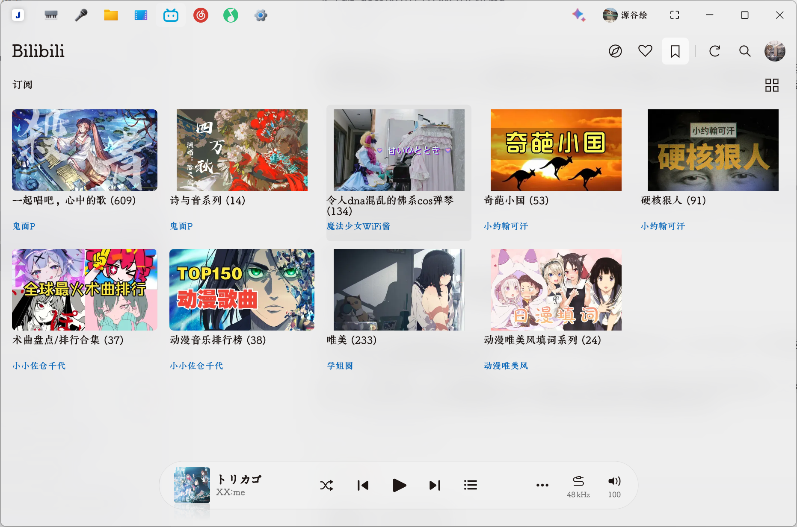
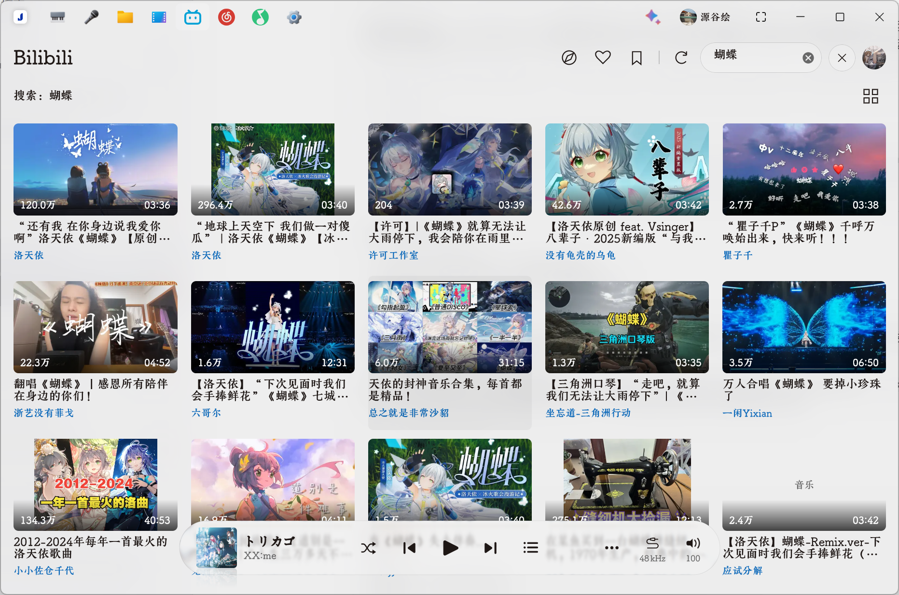
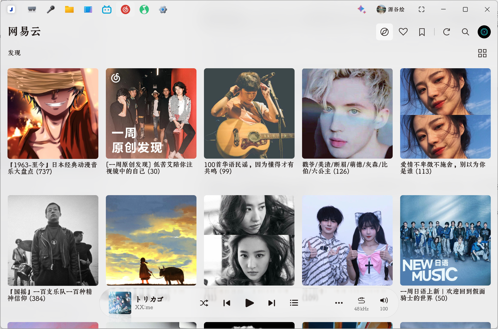
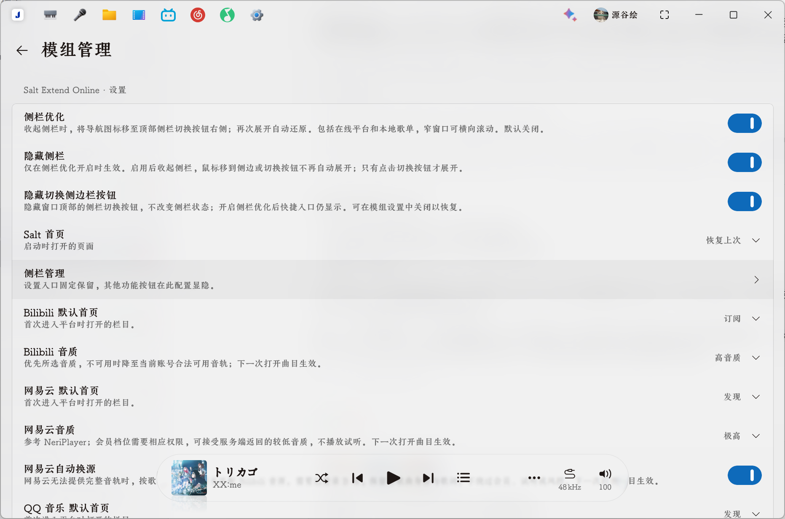

<div align="center">

# Salt Extend Online

**在 Salt Player 中听 Bilibili、网易云、QQ 音乐、酷狗音乐和 Apple Music**

浏览、搜索、管理歌单，沿用 Salt 原生播放队列、音效与歌词页。

[](https://steamcommunity.com/sharedfiles/filedetails/?id=3835352817)
[](https://github.com/YGHFv/Salt-Extend-Online/releases)
[](https://github.com/YGHFv/Salt-Extend-Online/actions/workflows/build.yml)

**0.9.4 · 开发预览** · Windows / Steam Salt 1.19.3

</div>

## 界面预览

实机截图，点击查看原图。

<table>
  <tr>
    <td width="50%" align="center">
      <a href="docs/images/bilibili-subscriptions.png"></a>
      <br><strong>Bilibili · 订阅合集</strong>
    </td>
    <td width="50%" align="center">
      <a href="docs/images/bilibili-search.png"></a>
      <br><strong>Bilibili · 搜索</strong>
    </td>
  </tr>
  <tr>
    <td width="50%" align="center">
      <a href="docs/images/netease-discovery.png"></a>
      <br><strong>网易云 · 发现歌单</strong>
    </td>
    <td width="50%" align="center">
      <a href="docs/images/plugin-settings.png"></a>
      <br><strong>模组设置 · 侧栏与播放偏好</strong>
    </td>
  </tr>
</table>

## 主要功能

| 功能 | 说明 |
| --- | --- |
| 五平台浏览 | Bilibili / 网易云 / QQ 音乐 / 酷狗音乐发现、搜索、收藏；Apple Music 热门、搜索、资料库专辑和歌单 |
| 酷狗音乐在线接入 | KA Music API 服务接入，扫码登录、推荐歌单、搜索、歌单、原生播放与 KRC 逐字歌词 |
| QQ 个性化推荐 | 发现页增加每日推荐和猜你喜欢，登录后读取账号专属歌曲 |
| Apple Music 播放 | MusicKit 浏览器解码并将 PCM 交给 Salt 原生播放器，支持队列、音量、跳转和歌单；需要有效订阅 |
| 原生播放与歌单 | 双击播放、整单播放、插播、添加到 Salt 歌单，在线队列与歌单支持重启恢复 |
| 播放页视频 | B站曲目及带 MV 的网易云／QQ 歌曲，在播放页右上角全屏按钮左侧显示视频按钮，点击在页内播放，再次点击返回封面和歌词 |
| 逐字歌词 | 网易云 YRC、QQ 音乐 QRC、酷狗音乐 KRC，兼容普通 LRC 与翻译，显示在 Salt 原生歌词页 |
| 列表与封面 | 卡片／单列／双列切换，合集搜索、排序、分页，列表及播放封面加载 |
| 音质与缓存 | B站 6 档、网易云 8 档、QQ 音乐 10 档、酷狗音乐 3 档音质偏好，按实际队列预缓存后三首 |
| 界面设置 | 侧栏管理、自动换源、音质、默认栏目分别进入二级页面，跟随 Salt 主题 |
| 平台收藏与订阅 | 歌曲右键收藏到当前平台歌单，已有歌曲置灰；歌单右键订阅或播放全部 |
| 自动换源 | 网易云、QQ 音乐、酷狗音乐、Apple Music 可独立启用 Bilibili 备用音源，保留原歌曲信息和歌词 |
| 连续播放缓冲 | 播放读取按分段协调，慢速预加载不再锁住整首歌曲；Apple Music 连续内存缓冲并预热原生解码探测后的分段 |

## 安装与使用

1. 从 [Steam 创意工坊](https://steamcommunity.com/sharedfiles/filedetails/?id=3835352817) 订阅，或在 [Releases](https://github.com/YGHFv/Salt-Extend-Online/releases) 下载 `.spmod` 并导入 Salt 模组管理。
2. 启用模组并授予所需权限，包括 `CLASS_TRANSFORM`。更新后完整退出并重启 Salt，同 ID 旧版只保留一个启用实例。
3. 点击侧栏或顶部的 Bilibili / 网易云 / QQ 音乐 / 酷狗音乐入口，在平台页登录后浏览内容。双击曲目播放，右键可插播或加入 Salt 歌单。

网易云扫码和网易云／QQ「官方网页登录」需要 **Microsoft Edge**。登录使用独立临时浏览器环境，不读取日常浏览器已有账号；遇到平台风控时需在官方页面完成验证。

Apple Music 入口支持热门、搜索、我的专辑和我的歌单；点击账号图标在独立 Edge 中登录后，双击歌曲进入 Salt 原生队列。播放使用后台私有 Edge 的 MusicKit 解码，PCM 音频交给 Salt 的 BASS 通道，使用 Salt 的音量、音效、暂停和进度控制。整单播放、插播和本地歌单保存沿用原生队列。需要有效 Apple Music 订阅；缺少 catalog ID 的资料库曲目不可点播。插件的 PCM 缓存有内存上限，Salt 的原生读取器另有临时 Range 文件；未启用持久音频缓存或后三首预下载。浏览器 PCM 到 BASS 已完成合成音频验证，订阅账号的实际歌曲播放仍待登录验收。

酷狗音乐接入使用参考项目的第三方 **KA Music API 服务**（`music.api.hoilai.cn`）。扫码后会保存该服务的 session ID，用于酷狗音乐账号、歌单和音轨请求；退出即撤销本地凭据。公开搜索与推荐可匿名浏览，播放可能要求扫码并完成平台验证。
音轨地址保留接口的原始协议：两个官方 `fs.youthandroid*.kugou.com` 音频节点使用 HTTP，其余地址使用 HTTPS；账号凭据仅发送至 HTTPS API。已验证三首真实酷狗音乐音轨经 Salt 原生解码器完整解码及进度跳转。

音质以当前账号的官方权限为准，只播放可访问的完整音轨，不提供试听替代、会员或风控绕过。B站搜索需要登录，网易云部分匿名接口也可能要求登录。

## 版本与兼容

当前版本 **0.9.4** 修复视频取帧的额外等待、重复读取和音频同步的频繁精确跳转，详见 [视频流畅度修复](docs/VIDEO_PACING_0.9.4.md)。0.9.3 的 Direct3D 崩溃修复与播放图标见 [视频渲染修复](docs/VIDEO_RENDER_0.9.3.md)。0.9.2 播放页内 B站视频和网易云／QQ MV 见 [播放页视频](docs/PLAYBACK_VIDEO_0.9.2.md)。0.9.1 配置、收藏与订阅操作见 [配置与歌单更新](docs/SETTINGS_PLAYLISTS_0.9.1.md)。0.9.0 修复酷狗音乐音频 CDN 的 TLS 失败并验证实际原生解码，详见 [酷狗音乐播放修复](docs/KUGOU_PLAYBACK_0.9.0.md)。MusicKit → PCM → Salt 的实现和实际订阅歌曲待验收状态见 [Apple Music 原生播放](docs/APPLE_NATIVE_0.8.51.md)。历史修复见 [更新记录](docs/HISTORY.md)。

实际回归基线为 **Windows / Steam Salt 1.19.3**。模组使用官方插件接口及部分原生 UI／播放内部绑定，按所需接口结构检查兼容性；未来宿主更新可能影响部分功能。

自动回归覆盖原生界面、播放生命周期、封面和登录协议，并验证本机独立 Edge 启动。远端用户账号风控、会员内容及真实连续发声仍需实机验证。

## 开发与文档

完整构建需要 Python 3、JDK 25、PowerShell 和合法安装的 Salt：

```powershell
./scripts/setup-native-ui.ps1
./scripts/build-local.ps1 -SaltHome 'D:\path\to\Salt Player for Windows' -JdkHome 'C:\path\to\jdk25' -Experimental
```

输出位于 `plugin/build/libs/`。提交到 `main` 后先运行 GitHub 离线回归，再由仓库专用 Windows runner 完整回归和打包；提升版本号后自动发布开发预览 Release。

[构建指南](docs/BUILD.md) · [自动发版](docs/SELF_HOSTED_RELEASE.md) · [架构](docs/ARCHITECTURE.md) · [更新记录](docs/HISTORY.md) · [反馈问题](https://github.com/YGHFv/Salt-Extend-Online/issues)

参考项目：[NeriPlayer](https://github.com/YGHFv/NeriPlayer) · [mygo-qyin](https://github.com/Amamiya23/mygo-qyin) · [MusicOne](https://github.com/HGODLK/MusicOne) · [MineRadio Apple Music Edition](https://github.com/FHJI-lgtm/MineRadio-Apple-Music-Specially-Customized-Edition) · [kgka Music](https://github.com/umr-xiaomai/kgka_Music_hl)。来源与许可见 [第三方声明](THIRD_PARTY_NOTICES.md)。
