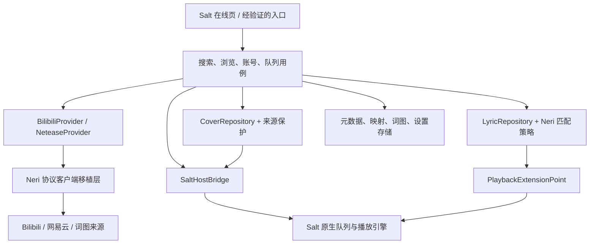

# Salt Extend Online 设计

状态：设计预览 / 部分核心已实现，未接通在线播放。参考核对日期：2026-11-06。

## 1. 产品定位

为 Salt Player 桌面版提供 **B 站 + 网易云在线音乐库**，采用参考 WebDAV 模组的
“远端目录浏览、按需在线播放”产品模式，词图获取对齐指定 NeriPlayer 分支。
不把 Android NeriPlayer 整个嵌入 Salt，不启用另一套播放器，不引入公共中转服务器。

建议名称：**Salt Extend Online / 音理在线**；稳定插件 ID：`io.github.yghfv.saltneri.online`。

### 首版范围

| Bilibili | 网易云 | 共用能力 |
| --- | --- | --- |
| 视频搜索、BV/AV/短链导入 | 单曲搜索、歌曲分享链接导入 | Salt 原生播放、暂停、拖动、队列 |
| 收藏夹、合集／多分 P 浏览 | 用户歌单、歌单链接浏览 | 本机账号授权、会话失效提示 |
| 每个 CID 独立入队 | 原歌曲 ID 独立入队 | 原封面、手动词图匹配、逐行／逐字歌词 |
| 按账号权限选择 DASH 音轨 | 按账号权限选择／降级音质 | 原文／翻译／音译、偏移、本地元数据缓存 |
| CC 人工字幕／AI 字幕可选 | 原生 YRC/LRC、翻译、音译 | 明确显示来源与错误，不跨版本强配 |

不纳入首版：视频画面、弹幕、评论、公开代理、自动整曲下载、远端历史回写、
QQ 在线播放、Android 移植、全局 Hook、未经验证的跨平台自动换音源。
网易云→B 站换源可作为后续显式开关；若实现，必须标明实际音源和版本，不冒充原曲。

## 2. 已核实的边界

### Salt 公开 API

核对官方 `0.1.0-dev22` 源码，而非仅参考教程示例：

| 需求 | 公开能力 | 接入结论 |
| --- | --- | --- |
| 开关插件、配置、提示 | `SpwPlugin`、`ConfigManager`、`Ui.toast` | 可直接用 |
| 歌词提供 | `onBeforeLoadLyrics` / `onAfterLoadLyrics` 返回 `String?` | 可直接用，但格式支持需宿主验证 |
| 读取当前项／曲库 | `getCurrentMediaItem`、`Library` | 需要 `LIBRARY_READ`；当前项查询会阻塞 |
| 暂停、继续、切歌、拖动 | `WorkshopApi.Playback` | 可直接用，但 `play()` 仅继续，不装载新曲 |
| 新建在线媒体、添加队列 | 无公开入口 | 必须宿主适配或新增官方 API |
| 解析媒体 URL / 请求头 | 无公开回调 | 必须宿主适配或新增官方 API |
| 为歌曲写入封面／数据库 | 无公开入口 | `LIBRARY_WRITE` 仅预留，不能据此实现 |
| 原生导航页／菜单 | 没有稳定页面注册 API | 只使用经验证的 UI Hook；不打开浏览器/独立窗口 |
| 方法／Compose Hook | `hookRegistrar`，需 `CLASS_TRANSFORM` | 已静态核验 Steam 1.19.3 侧栏/导航调用点；实际界面待验收 |

`MediaItem` 是快照，不是可写媒体构造入口。不要杜撰 `playUrl`、`addTrack`、
`setCover`，也不要把逻辑 URI 填入 `path` 就宣称 Salt 能播放。
官方 Hook 不支持普通 `suspend` 目标；UI Hook 要求匹配宿主编译器版本和实际调用点。

Steam 参考项公开说明只有“WebDAV / AList 音乐库同步与在线播放”。首轮只参考产品模式；
随后用户提供本机路径，已检查安装的 WebDAV 0.2.2 包并核对真实宿主，
结果见 [Steam 1.19.3 核验](HOST_AUDIT_1.19.3.md)。没有复制其未获许可的实现代码。

## 3. 结构



### 模块职责

当前仅有 `core` 和 `plugin` 骨架；下列是目标结构，不表示已经实现：

| 模块 | 职责 |
| --- | --- |
| `core` | 平台身份、流租约、词图选择、缓存资格、结果发布门禁；不依赖 Salt/Android |
| `platform` | 从 Neri 移植 B 站／网易云协议与授权、词图来源客户端；适配 JVM 网络层 |
| `lyrics` | LRC/YRC/TTML/KRC 的结构化解析、翻译音译对齐、宿主序列化 |
| `storage` | SQLite 元数据、图片与原始歌词文件、账号加密存储、缓存清理 |
| `application` | 搜索分页、浏览歌单、流解析和错误恢复；统一本机离线模式 |
| `plugin` | PF4J 生命周期、配置、歌词扩展、经验证的宿主和 UI 适配 |

优先纯 JVM Kotlin 移植 Neri 协议与策略，降低两套规则漂移；当前 Java 小核心用于验证独立契约。
不直接依赖 Neri Android `app` 或带 `Application` / SAF / Media3 的运行时模块。
抽取 HTTP、日志、缓存、账号存储接口替换 Android 实现，保留原策略测试与 GPL 来源说明。
Compose UI 只在需要原生页面且宿主版本匹配时编译，不为了配置页引入整套 UI 依赖。

## 4. 页面与交互

### 入口

最终入口为 Salt 侧栏“在线音乐”，包含“网易云 / Bilibili”两个平台标签。
以 Salt 原生字体、控件、间距、主题为准，不改主页和播放页，不重做播放器皮肤。
首次使用提示账号授权和网络来源；无已验证 UI 适配时，降级为可关闭的插件窗口，
但不因此宣称已经获得 Salt 在线播放能力。

### 布局

```text
在线音乐  [网易云] [Bilibili]                  [账号]
[ 搜索歌曲 / 粘贴歌曲、视频、歌单链接                 ]

我的歌单 / 收藏夹     最近浏览 / 搜索结果
目录树或分类列表      封面  标题 / 歌手或 UP 主 / 时长
                    [播放] [下一首播放] [添加到队列]
```

- 搜索按平台独立分页；防抖建议 350ms，换平台取消旧请求，失败显示重试入口。
- 歌单／收藏夹按目录浏览，而非连接后一次性平铺全部曲目；面包屑保留返回位置。
- B 站多分 P 导入先展示分 P 选择器；可选当前 P／选中 P／全部 P，禁止隐式只取第一页。
- 列表用源平台元数据。B 站 UP 主不是原唱，未人工匹配前不要冒充歌手。
- 播放项显示来源标识、实际音质；无权限时原位显示原因，不静默换到不相关视频。
- “匹配词图”同时展示歌名、歌手、专辑、时长差、版本、来源、逐字标记；低置信度仅人工确认。
- 词图可分别应用；改封面不触碰用户歌词，改歌词不改变实际音源和队列身份。
- 插件设置使用 Salt 声明式配置；账号登录使用专用界面，不把 Cookie 放进普通文本配置。

## 5. 身份和存储

### 三层身份必须分离

1. **媒体身份**：`netease:song:<songId>` 或 `bilibili:video:<bvid>:cid:<cid>`。
2. **词图身份**：匹配的网易云 ID、QQ songmid、酷狗音乐 ID/hash、AMLL 文件等，可与媒体不同。
3. **宿主身份**：Salt 当前版本内部媒体 ID，由适配层映射；不假设跨设备／删库后稳定。

短链接、AV 号、网页 URL 是输入，先规范化成媒体身份。B 站未知 CID 的输入不能进入播放队列。
同视频不同 CID 的歌词、时长、URL 和播放进度完全隔离。网易云单曲保持原 ID，
不要把播放 URL、token、歌名散列或人为 `avid * 10000 + page` 当长期主键。

### 目标记录

```text
OnlineTrack
  key: TrackKey
  title / artists[] / album / durationMs
  providerMetadata: bvid, aid, cid, page, uploader 或 songId, albumId
  originalCover: CoverReference?
  metadataMatch: SourceIdentity?
  coverOverride / lyricOverride / overrideRevision

StreamLease  [只驻留内存]
  trackKey / accountScope / quality / primaryUrl / backupUrls[]
  requiredHeaders / resolvedAt / expiresAt? / contentType

LyricDocument
  originalSource / sourceIdentity / rawFormat / rawOriginal
  translatedTrack / romanizedTrack [各自来源和对齐关系]
  lines[{startMs, endMs, text, words[], translation?, romanization?}]
  userConfirmed / sourceOffsetMs / userOffsetMs / revision

HostBinding
  profileId / hostMediaId / trackKey
```

建议 SQLite 表：`tracks`、`collections`、`collection_tracks`、`source_matches`、
`lyric_overrides`、`cover_overrides`、`host_bindings`、`schema_migrations`。
原始词图按内容 hash 存文件，数据库存索引；用户编辑与可回收网络缓存分开存。
收藏夹是账号域数据，退出登录必须清理内存索引和可见状态；本地自建歌单需独立的用户操作保留策略。
缓存清理不能删除用户编辑、匹配确认和本地自建歌单。

## 6. 网易云在线播放

### 路径

`登录/匿名可访问入口 → 搜索/歌单 → 按 ID 详情 → 原生媒体项 → 即时取流 → Salt 播放`。

- 首期优先二维码登录，保留网页登录作为用户操作的后备；不收集密码。
- 复用 Neri 的 WEAPI/EAPI 请求与会话维护，非任意第三方公共 API。
- 搜索参考 `/weapi/cloudsearch/get/web`；详情参考 `/weapi/v3/song/detail`。
- 取流参考 EAPI `/song/enhance/player/url/v1`，保留原返回音质、编码与账号权限判断。
- 不把 `url != null` 当唯一可播条件；解析无权限、试听、地区、账号失效等原始状态。
- 按用户音质偏好，在原账号有权取得的候选中降级；最终实际音质标在 UI。
- URL 只在播放／近邻预取时获取，依据平台返回有效期提前失效，未知有效期则短暂复用。
- 403／失效候选：丢弃租约、重取一次；仍失败则报错，不无限重试，不自动“解锁”。

词图：同一歌曲 ID 拉取专辑 `al.picUrl`，`http` 规范化为 `https`；
调用 Neri `/song/lyric/v1` 新歌词接口，完整保存 YRC/LRC、翻译、音译及字段回退。
解析结果而非后缀名决定是否逐字。

## 7. Bilibili 在线播放

### 路径

`二维码授权 → BV/AV/短链/搜索/收藏夹 → 视频详情和分 P → 确定 aid+cid → DASH 音轨 → Salt`。

- 移植 Neri WBI session/signing、请求头和账号会话；接口不是把浏览器 URL 当音频。
- 详情参考 `/x/web-interface/wbi/view`；搜索参考 `/x/web-interface/wbi/search/type`。
- 取流参考 `/x/player/wbi/playurl`，按实际 `dash.audio` 及 Dolby/FLAC 候选选择。
- 保留 Neri `BiliAudioSelector` 的质量标记与降级语义；不能只按码率把所有特殊音轨混排。
- 原 URL 与备用 URL 是一份租约；DASH 音频无需下载视频或整段转码后才能播。
- Referer 应是对应视频页；媒体域按已核实平台规则附加请求头，Cookie 不转发到任意 CDN。
- 拖动需要宿主支持 HTTP Range；若只能接 URL 无请求头，须验证签名流是否无需额外头，
  否则本版本禁用该路径，不默认开启代理。
- 403／过期优先重取租约；WBI 会话失效重建一次，风控明确提示稍后重试。

默认封面为视频原图，不强制裁掉长宽比；列表缩略图使用 Neri B 站图片操作规则。
用户手动选取歌曲元数据／封面后继续播放原 BV+CID 音源，映射不替换媒体身份。

## 8. 歌词与 NeriPlayer 对齐

**同源集合不等于同策略。** 不实现“网易云→QQ→酷狗音乐→AMLL”这样的固定万能回退链。
完整分支与源码对应见 [对齐清单](NERIPLAYER_PARITY.md)。

### 在线主路径

1. 已确认、可解析的手动原文优先。
2. 经过 `shouldTryPreferredLyricSource` 资格判断，尝试用户指定的来源。
3. 读取已有匹配／保存的词；显式清空、未设置、网络失败必须区分。
4. 按平台获取：网易云原生词；B 站在 CC 开关启用时加载对应 CID 的字幕。
5. 已成功使用 CC、已有逐字、关闭优先逐字或关闭 AMLL：保留平台结果。
6. 其余情况下尝试 AMLL **可用逐字**；失败保留平台结果，不伪造逐字时间。

这不是全量 Neri `getLyrics()` 的重写；本地、服务器、YouTube 分支不在首版范围内。
翻译／音译需要各自来源与对齐关系，切换原文必须同步更新发布状态，不能残留上一来源的翻译。
CC 原文不混入外部歌曲翻译冒充同一字幕；手动多源补全依照 Neri 的独立轨来源处理。

### 人工匹配与指定来源

- 支持网易云、酷狗音乐、QQ、LRCLIB、AMLL；QQ 不扩展到在线播放。
- 以歌名、主歌手、专辑、时长、版本、时间轴有效性评分；保留 Neri 的中文归一与版本规则。
- 手动列表允许展示低置信度；自动应用必须满足高置信度、可靠身份和时长门禁。
- 一般外部歌词时长容差：`min(15000, max(7000, durationMs * 6 / 100))`；未知时长不能自动通过。
- AMLL 时长来自歌词末行，**不能**套用普通音频时长容差：较短容差为 15% / 30–60 秒，
  较长容差为 10% / 12–30 秒，另有 `requireDurationMatch` 未知时长门禁。
- Live／录音室、翻唱／原唱、加速／原速、伴奏／人声不能仅因歌名接近而自动匹配。
- 排序复用 Neri 原规则，逐字偏好是排序层级，不只是随意加几分。

### B 站 CC

已登录才尝试字幕列表；参考 `/x/player/wbi/v2`，按 aid+cid 隔离。
支持语言偏好、人工轨、AI 轨；人工失败尝试后备轨。翻译轨按 Neri 选择／对齐。
CC 只有行时间时保持逐行，不均分文字伪造逐字。
轨列表在 Neri 中缓存 10 分钟；签名过期或所有轨失败后重新取列表。
后备轨命中、翻译不完整的结果不进入长期成功缓存，下一次仍可重试首选轨。

### Salt 输出

内部始终保留原始 LRC/YRC/KRC/TTML 与结构化时间轴。
公开歌词扩展返回文本，不接收 `LyricsLine` 写入；不能把读回调当写 API。
以真实 Salt 测试确定支持格式。已支持逐字格式优先直接输出；
不能支持时输出标准 LRC 并标记降级，翻译／音译的表达方式另行测试。
所有偏移只应用一次；source offset、用户偏移、CC 专属偏移分开存，
TTML 禁止外部实体解析；畸形、全零塌缩、越界时间轴遵循 Neri 校验，不压成假时间轴。

## 9. 封面

- 网上播放项使用 `customCover` → 当前 `coverUrl` → 原始封面的候选语义，
  实际可用性与失败保持规则依照 Neri，不能搜到一张图片就覆盖用户选择。
- 网易云用歌曲详情专辑封面；B 站用视频图。手动匹配封面使用所选歌曲的详情，不另做图片搜索。
- B 站缩略图仅对 `.hdslb.com` / `.biliimg.com` 执行 `@<w>w_<h>h_1c.webp`，
  替换已有路径末端图片操作，保留 query/fragment。尺寸按列表与播放页需求区别。
- 保留原图比例，播放页由 Salt 渲染；“相同获取来源”不意味着 Android 与 Salt 的裁剪 UI 必须一致。
- 新候选下载和解码成功后再替换；失败保留同一歌曲已有可用图，换曲则不保留上一首的图。
- 图片流设字节／像素上限，校验真实类型后原子写入；不要依据文件名信任媒体。
- 原图 hash + 派生尺寸为缓存键，不含 Cookie 或签名 URL；手动封面放不可自动回收的独立区。

## 10. 生命周期、性能和错误

- `start()` 只做短初始化与注册，登录、搜索、词图、解码在后台执行；不能启动时同步拉完整库。
- `stop()` 取消插件任务、失效 publication generation、释放监听／Hook／窗口／连接；重新启用重新注册。
- 请求域包含 `trackKey + accountScope + preferences + overrideRevision`；
  完成后再检查发布票据，不让上一首、旧账号、已停用实例覆盖当前视图。
- 任务取消原样传播，不吞成“没有歌词”；空结果、清空、超时、鉴权失败分别建模。
- 一般网络超时／5xx 可以有限退避；401/403先按错误种类处理，风控不进行高频重试。
- 同身份请求 single-flight；元数据长缓存，播放租约短缓存，下一首只预取元数据／租约，不整曲下载。
- UI 高频回调只读内存快照，不在 `onPositionUpdated` 做网络或数据库查询。
- 缓存隔离账号；离线时可浏览此前允许保留的元数据，但没有音频缓存不宣称可离线播放。

## 11. 安全、权限与发布

- 登录仅使用用户主动扫码／网页登录的会话，不读取浏览器 Cookie 数据库或其他软件凭据。
- 凭据不写 `ConfigHelper` 普通配置、日志、歌单、同步或 `.spmod`；
  Windows 使用系统保护存储，Linux 使用系统 keyring；无安全存储时只保留会话内存。
- URL 和 HTTP 请求头日志脱敏；任何重定向重新检查域、协议、凭据作用域；
  不向 AMLL/GitHub/LRCLIB/任意 CDN 发送 B 站或网易云账号 Cookie。
- 用户链接不允许 `file:`、`javascript:`、本机和内网目标；短链只允许已核实平台域。
- 按能力申请权限：歌词单独扩展不额外申请曲库写权限；读取曲库才申请 `LIBRARY_READ`；
  已验证 Hook 才申请 `CLASS_TRANSFORM`，拒绝后禁用对应能力。当前预览骨架不申请高危权限。
- API 所列权限不是 JVM 网络／文件系统沙箱，不能向用户承诺插件受到它未提供的隔离保护。
- 不绕过 DRM、付费、地区或账号限制；仅处理平台按当前用户权限返回的可播放内容。
- 发布 `.spmod` 同时提供源码、固定 API 版本、宿主兼容列表、权限说明、第三方许可；
  GPL 移植与宿主的链接／分发兼容性需在发布前核对。

## 12. 开发顺序与验收

| 阶段 | 交付与通过条件 |
| --- | --- |
| P0 宿主可行性 | 取得准确宿主版本；验证媒体创建、入队、取流头、封面、歌词格式；不满足则停用在线播放方案 |
| P1 核心／平台 | QR 授权、搜索、链接解析、歌单／收藏夹、流租约；真实账号权限错误测试 |
| P2 网易云闭环 | 搜索→详情→队列→播放→拖动→下一首；相同 ID 词图完整；URL 过期能恢复 |
| P3 B 站闭环 | BV/AV/短链、多 P、收藏夹；每 CID 独立音轨、进度、CC；请求头和 Range 实测 |
| P4 词图对齐 | 移植 Neri 匹配、解析、来源优先级与回归 fixtures；用户编辑保护；Salt 逐字／翻译输出验证 |
| P5 UI 与发行 | 原生入口、禁用／权限撤销／升级清理、跨系统适配、兼容列表和可回滚发行包 |

### 必测场景

1. 网易云普通歌曲／账号会员歌曲／无权限歌曲／试听，选择音质与显示实际音质一致。
2. B 站同 BV 的 P1、P2、P3 不共享错误 CID、时长、URL、歌词与进度。
3. 网易云 YRC、纯 LRC、翻译／音译缺失；AMLL 命中／超长／正常 outro；选择和 Neri 同 fixture 结果一致。
4. CC 人工轨失败、AI 后备轨、语言偏好、翻译失败、签名过期；不永久缓存不完整结果。
5. Live 与录音室、翻唱、加速版本；自动匹配拒绝，手动确认仍可用且保留来源。
6. 已确认的用户歌词与封面不被背景更新覆盖；显式清空与缺字段按上游语义区分。
7. 连续快速切歌、换账号、清缓存、禁用再启用，旧请求不覆盖新状态。
8. 媒体 Range 拖动、CDN 备用、URL 过期；拒绝高危权限和宿主升级后能力关闭。
9. 网络／解码失败保留同歌已可用图，不残留上一首图；无效原文不残留上一来源翻译。
10. `.spmod` 不打入 Salt API／Kotlin／Compose 宿主依赖，无账号信息、用户编辑或本机缓存。

设计不承诺工期；P0 的宿主接入是后续实现的关键决策门，不应先做一堆界面再验证。

## 0.7 原生页面落地

以用户给出的界面位置为准：左侧“音乐库”下面增加 Bilibili 与网易云。页面通过宿主原生导航构建器注册，不覆盖音乐库/设置/其他模组页面。
复用已核验的 SidebarItemLayout、SaltTheme 字体/颜色/圆角，将侧栏专有 CompositionLocal 样式显式传给平台页，避免在页面作用域缺少 SidebarItemStyle。
Kotlin/Compose compiler 固定2.4.0；编译依赖只读且不入包，所有生成的宿主调用符号逐项校验。细节和当前未验收项见 `NATIVE_UI_PROGRESS.md`。
